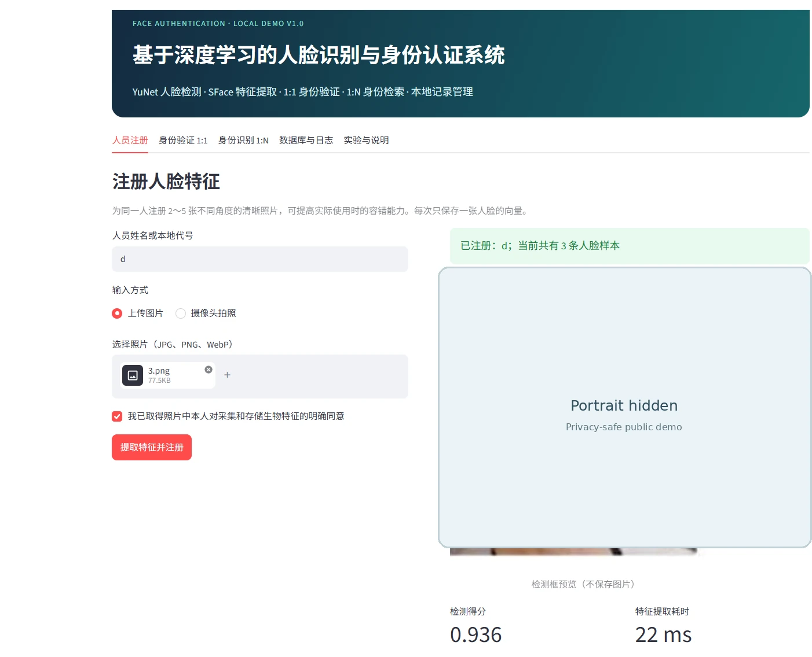
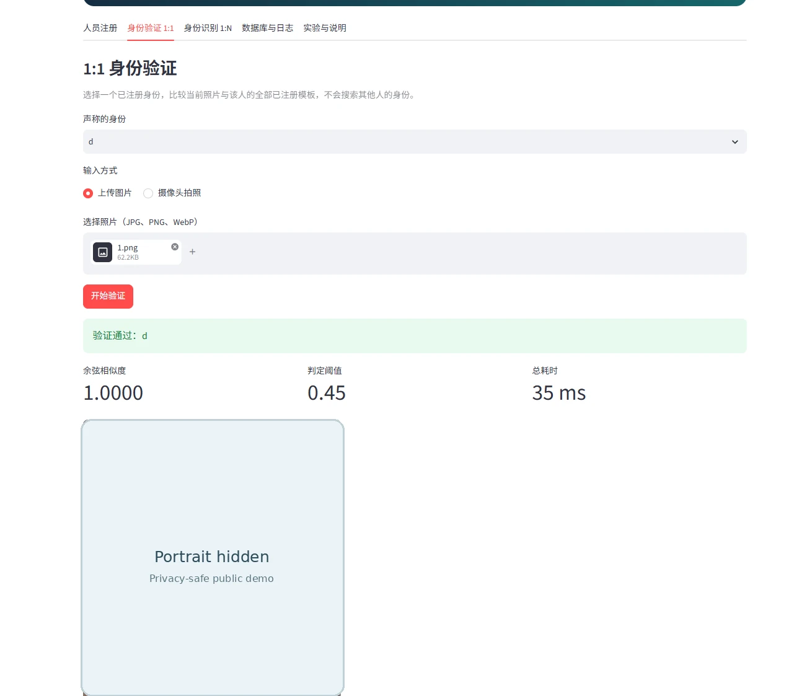
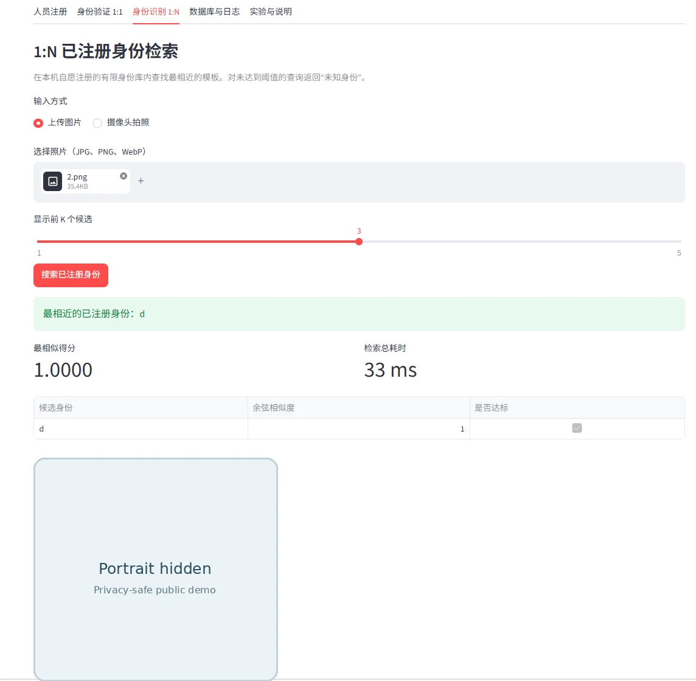
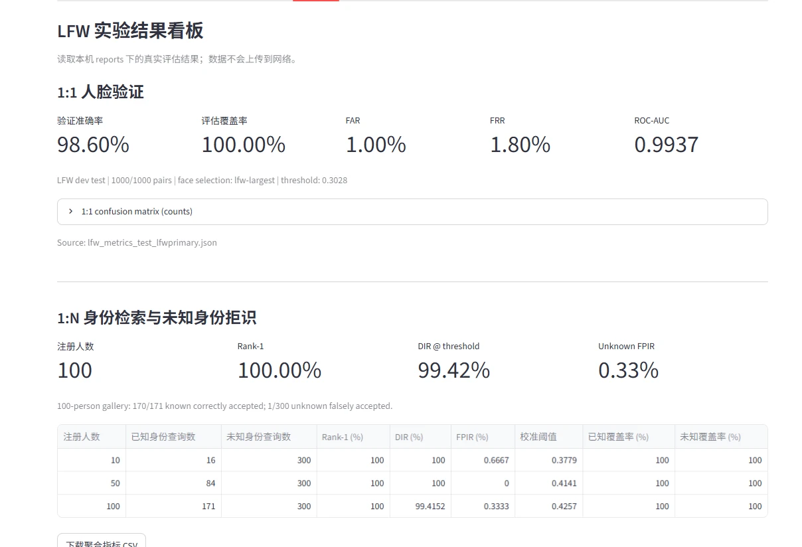

# 基于深度学习的人脸识别与身份认证系统

FaceAuth v1.6 · Python 3.11 / OpenCV DNN / NumPy / SQLite / Streamlit

这是我在 Windows 上开发的一个本地人脸识别项目。使用 OpenCV Zoo 的 YuNet 检测人脸、SFace 提取特征，再根据特征向量的余弦相似度完成身份验证和检索。项目包含人员注册、1:1 验证、1:N 搜索、未知身份拒识，以及用于复现实验的评估脚本和 Streamlit 页面。

YuNet 和 SFace 都是第三方预训练模型。本项目没有从零训练识别网络，开发内容主要是图像处理、推理集成、多模板匹配、SQLite 数据管理、阈值校准和实验评估。

## 系统运行截图

这四张图来自本地实际运行。公开版本把前三张图中的人物照片区域遮蔽了，保留界面操作、检测结果、分数与耗时。截图中出现的 `1.0000` 只是单次功能演示得分，不能据此判断不同照片间的识别准确率。

### 人员注册

上传照片并确认已获得本人同意后，系统提取人脸特征并保存到本地数据库。同一身份可以注册多张照片，图中已登记 3 条特征模板。



### 1:1 身份验证

选择已注册的身份，上传待验证照片。程序只检索该身份的模板，返回余弦相似度、判定阈值和耗时。



### 1:N 身份检索

直接上传照片，在全部已注册模板中搜索，并列出 Top-K 候选。最高分未达到阈值时返回“未知身份”。



### LFW 实验看板

看板读取本地测试报告，集中展示 1:1 验证指标、1:N 不同身份库规模的检索结果和阈值。



## 主要实现

一次人脸处理经过以下步骤：

1. YuNet 检测人脸框和五个关键点。对尺寸较大的竖屏照片，检测模块支持多尺度尝试。
2. 根据关键点对齐人脸，再由 SFace 提取并归一化特征向量。
3. 注册时把特征模板写入 SQLite，允许一个身份对应多个模板。默认不持久化原始照片。
4. 1:1 验证只比较所声明身份的模板；1:N 则遍历本地身份库。每个身份取最高余弦相似度，再与阈值比较。
5. Streamlit 页面提供注册、验证、搜索、数据库管理和日志查看；另有独立实验看板。

正常注册和验证采用严格单人脸规则。若一张照片中检测出多张人脸，系统会拒绝这次操作，以免把错误的人当作认证对象。向量检索使用 NumPy 精确计算，目前没有接入 FAISS。

## 实验结果

以下数据来自本机实际运行的 LFW funneled 实验。公开仓库保留了[指标汇总和评估说明](docs/benchmarks/LFW_RESULTS.md)，完整 JSON 报告保存在本地 `reports/`，不会随源码一起上传。

### 1:1 人脸验证

使用 LFW 开发验证配对（2,200 对）选择阈值 `0.3028`，再在开发测试配对（1,000 对）上固定该阈值评估。

| 测试配对数 | 有效配对覆盖率 | Accuracy | FAR | FRR | ROC-AUC |
|---:|---:|---:|---:|---:|---:|
| 1,000 | 100% | **98.60%** | 1.00% | 1.80% | 0.9937 |

测试配对各有 500 对同身份和不同身份。最终正确接受 491 对同身份、正确拒绝 495 对不同身份；另外有 9 次错误拒绝和 5 次错误接受。

### 1:N 身份检索与未知身份拒识

按 10、50、100 人构建身份库。每人使用 2 张照片注册，最多使用另 2 张照片作为已知身份查询；每种规模有 300 次未知身份查询。验证与测试身份不重叠，各身份库规模的拒识阈值在验证阶段校准后固定用于测试。

| 注册人数 | 已知身份查询 | 未知身份查询 | Rank-1 | DIR | FPIR |
|---:|---:|---:|---:|---:|---:|
| 10 | 16 | 300 | 100.00% | 100.00% | 0.67% |
| 50 | 84 | 300 | 100.00% | 100.00% | 0.00% |
| 100 | 171 | 300 | 100.00% | **99.42%** | 0.33% |

`Rank-1` 是不考虑阈值时，正确身份排在首位的比例。`DIR` 还要求正确身份的得分达到阈值。`FPIR` 是未知身份被错误接受的比例。

在 100 人库中，171 次已知查询有 170 次正确接受；300 次未知查询有 1 次错误接受。50 人库的 0% FPIR 仅表示本次 300 次查询中没有观察到错误，不能推断真实误识率为零。

这里有两个实验口径需要说明：

- **LFW 主脸选择：** LFW 图片以主体人脸为中心，离线评估使用 `lfw-largest` 选择面积最大的检测框。Web 注册和认证采用 `strict`，拒绝多张检测人脸；因此 LFW 成绩不等于 Web 实际场景的安全性能。
- **评估协议：** 上述 1:1 是 LFW 开发配对实验，1:N 是自定义的身份不重叠划分，均不是 LFW 官方 10 折成绩。1:N 的“模型 + 检索”耗时是离线估算，不包含浏览器渲染和数据库操作。

## Windows 本地运行

使用 VSCode PowerShell。下面沿用本项目的开发目录 `E:\AIdemo\face_auth_system`；换电脑时按实际路径修改第一行。

```powershell
cd E:\AIdemo\face_auth_system
conda create -n faceauth python=3.11 -y
conda activate faceauth
python -m pip install -r requirements-dev.txt
python scripts/download_models.py
python scripts/verify_env.py
python -m pytest -q
python scripts/smoke_test.py
streamlit run app.py --server.fileWatcherType none
```

启动后访问 `http://127.0.0.1:8501`。`.streamlit/config.toml` 把服务绑定在 `127.0.0.1`，默认只允许本机访问。

首次使用需要联网下载 YuNet 和 SFace 的 ONNX 权重。`scripts/download_models.py` 会校验下载文件的 SHA-256；模型权重不在 GitHub 仓库里。如果 `faceauth` 环境已配置好，跳过创建环境的步骤即可。

只查看实验看板时，可以单独运行：

```powershell
streamlit run experiment_dashboard.py --server.fileWatcherType none
```

这个页面仅读取汇总报告，不需要加载人脸模型或连接人员数据库。

## 复现实验

先准备 LFW 数据：

```powershell
python scripts/prepare_lfw_dataset.py
```

1:1 先用验证配对校准阈值，再在测试配对上使用固定阈值：

```powershell
python scripts/eval_pairs.py `
  --split val `
  --csv data/lfw_pairs/val_pairs.csv `
  --images data/lfw_home/lfw_funneled `
  --face-selection lfw-largest `
  --target-far 0.01 `
  --calibration-out reports/lfw_threshold_val_lfwprimary.json `
  --out reports/lfw_metrics_val_lfwprimary.json

python scripts/eval_pairs.py `
  --split test `
  --csv data/lfw_pairs/test_pairs.csv `
  --images data/lfw_home/lfw_funneled `
  --face-selection lfw-largest `
  --threshold-file reports/lfw_threshold_val_lfwprimary.json `
  --out reports/lfw_metrics_test_lfwprimary.json
```

1:N 一键运行脚本会依次完成验证阶段的阈值校准和测试阶段的评估：

```powershell
& .\scripts\run_lfw_1n_windows.ps1
```

请在已经激活 `(faceauth)` 的当前 PowerShell 终端执行。另开一个 PowerShell 进程可能会使用其他 Python 环境。

## 项目目录

```text
face_auth_system/
  app.py                     Web 主页面
  experiment_dashboard.py    独立实验看板
  faceauth/                  检测、特征提取、匹配、SQLite 与评估
  scripts/                   模型下载、数据准备、评估和摄像头演示
  tests/                     自动化测试
  docs/                      截图、汇总指标、实验协议及使用说明
  data/                      本地数据集和人脸模板库（不上传）
  models/                    ONNX 预训练权重（不上传）
  reports/                   详细实验输出（不上传）
```

## 数据安全与项目边界

这是一个本地演示和实验项目，**没有实现可靠的活体检测**。照片翻拍、视频重放等攻击仍可能通过匹配；系统也没有数据库加密和管理员账号权限控制。不要将它直接用于门禁、考勤、支付等需要可靠安全认证的场景。

系统默认不保存上传的原始照片，但 SQLite 中的特征向量依然是敏感生物识别数据。公开仓库排除了真实人脸图片、模板数据库、个人身份资料、完整本地日志和权重文件。注册和测试他人照片前，应取得本人同意。

YuNet 和 SFace 模型来自 OpenCV Zoo，其来源和许可见 [第三方模型说明](THIRD_PARTY_MODELS.md)。本仓库的整体源码尚未单独选择开源许可证，第三方模型许可不自动适用于本项目代码。

相关文档：[Windows 运行说明](QUICKSTART_WINDOWS_CN.md) · [1:N 评估协议](docs/LFW_IDENTIFICATION_V15_CN.md) · [GitHub 发布说明](docs/GITHUB_PUBLICATION.md)
